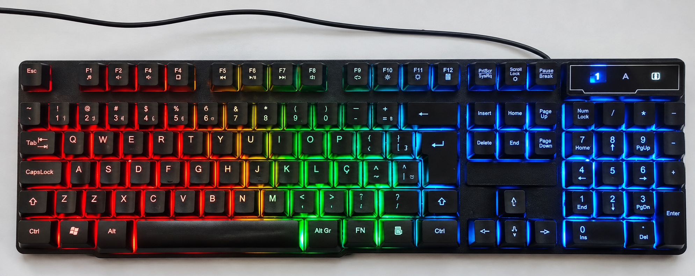
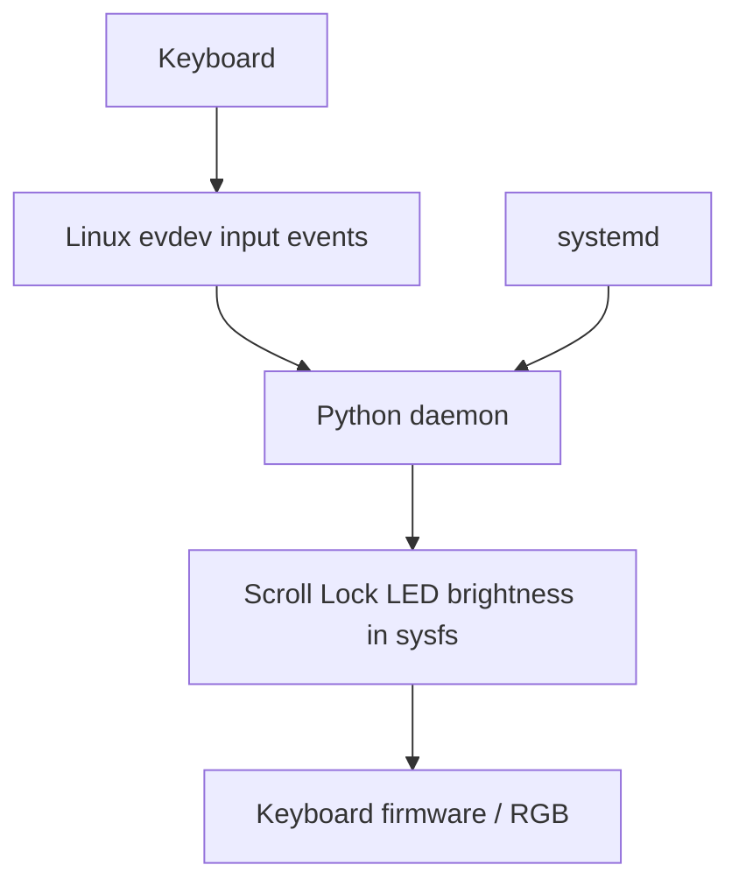

# Scroll Lock Keyboard RGB Fix

[](https://kernel.org)
[](https://python.org)
[](https://systemd.io)
[](https://wayland.freedesktop.org)
[](LICENSE)


[Português (Brasil)](README.pt-BR.md) · [Installation](#installation) · [Troubleshooting](docs/troubleshooting.md) · [Contributing](#contributing) · [Changelog](CHANGELOG.md)

A lightweight Linux background service for keyboards whose firmware switches RGB lighting on or off through the physical Scroll Lock LED. I started this project to address the problem on my own GNOME/Wayland setup. The daemon uses Python, evdev, sysfs and systemd rather than a proprietary RGB driver.

## The problem

I originally encountered this issue on my own Ubuntu desktop running GNOME/Wayland, with a generic wired gaming keyboard. Its firmware uses the physical Scroll Lock indicator as an on/off switch for the RGB backlight across the entire keyboard.

The keyboard can still be used for typing when its backlight is off. The problem is that pressing Scroll Lock does not reliably change the physical LED on affected GNOME/Wayland setups. Changes to Caps Lock or Num Lock can also reset that LED, unexpectedly turning off the backlight.

This project provides a background service that listens for Scroll Lock presses, writes the desired LED state through Linux sysfs and reasserts it after LED events. It targets this specific firmware behavior, not individual RGB colors, lighting effects or every RGB keyboard.

## Visual demonstration

The images below illustrate the keyboard that motivated this project and the two backlight states.

### RGB backlight off and on

| RGB disabled | RGB enabled |
|---|---|
|  |  |
| [Original photograph](docs/images/0-original.png) | [Original photograph](docs/images/1-original.png) |

### The Scroll Lock key


[Original photograph](docs/images/2-original.png)

The lighting symbol on the Scroll Lock key indicates its role on this particular keyboard. Its firmware uses the Scroll Lock LED state to switch the backlight on or off; the daemon does not directly control the individual RGB LEDs.

**Image note:** The displayed images are AI-enhanced versions of my original photographs. Some details, including key legends, may differ from the actual hardware. The linked originals are the reference for physical appearance. These images illustrate the problem and intended behavior; they are not evidence of a test of any specific daemon revision.

## How it works



- Discovers candidate keyboards advertising both Scroll Lock and A, and discovers Scroll Lock brightness nodes dynamically.
- Toggles the LED on a Scroll Lock press, ignoring key repeats and releases.
- Reasserts the desired state after LED events with a 50 ms settling delay.
- Retries discovery after a detected disconnection or when a device is missing, with a two-second interval.
- Runs under systemd, which is configured to restart the daemon.

The daemon uses the first eligible keyboard with exactly one Scroll Lock LED on the same Linux input device. It skips keyboards with missing or ambiguous LED links, even when another keyboard has a usable LED. The listener initializes the LED to off on each attachment; the previous RGB state is not persisted. Recovery and shutdown behavior still need broader validation.

## Compatibility and requirements

| Component | Requirement |
|---|---|
| OS | Linux with a functioning systemd manager |
| Runtime | System Python 3 (existing minimum target: 3.8) and evdev |
| Hardware | A keyboard whose backlight responds to the physical Scroll Lock LED |
| Access | sudo for installation, service management and privileged LED writes |
| Development | Git, Bash and Python with evdev installed |

The installer has package-manager branches for the following systems. This is **not** a hardware-tested compatibility matrix.

| Distribution family | Package manager | Dependency |
|---|---|---|
| Debian / Ubuntu / Linux Mint | apt | python3-evdev |
| Fedora / RHEL | dnf | python3-evdev |
| Arch / Manjaro | pacman | python-evdev |
| openSUSE | zypper | python3-evdev |
| apk-based systems | apk | py3-evdev |

The apk branch does not establish Alpine/OpenRC support: the project ships a systemd unit, not an OpenRC service. Package availability varies. Other compositors and distributions may work, but are not guaranteed. The original development target was GNOME/Wayland on Ubuntu; see the [historical technical guide](docs/RGB_ScrollLock_Ubuntu_EN.pdf).

## Installation

Review [install.sh](install.sh), [the service unit](scrolllock-rgb.service) and [troubleshooting](docs/troubleshooting.md) first. Use a noncritical machine or keyboard with an alternative input method available.

```sh
git clone https://github.com/kayo-willian/scrolllock-rgb-fix.git
cd scrolllock-rgb-fix
sudo ./install.sh
```

The installer checks for evdev, attempts to install it if missing, copies the daemon and unit, reloads systemd and enables and starts the service immediately. Python and Git must already be installed. It may change the system package state and overwrite the two destination files; inspect existing files before running it.

| Installed path | Purpose |
|---|---|
| `/usr/local/bin/scrolllock-rgb.py` | Python daemon |
| `/etc/systemd/system/scrolllock-rgb.service` | System-wide service |

**Privacy and privileges:** the shipped service runs as root and reads keyboard input events through evdev. The current code logs the monitored device, Scroll Lock toggles and errors, not arbitrary typed characters. It does not need network access for normal daemon operation. The installer may access package repositories. Do not treat root execution as a security guarantee; review the source before installing.

## Usage and diagnostics

Press Scroll Lock to toggle the light. Check service state and recent logs:

```sh
systemctl status scrolllock-rgb.service --no-pager
journalctl -u scrolllock-rgb.service -n 50 --no-pager
journalctl -u scrolllock-rgb.service -f
```

An active service can still be waiting for a device. Check the reported keyboard and LED path, then use the [troubleshooting guide](docs/troubleshooting.md) to test one identified LED. Do not write to every matching LED on a multi-keyboard machine.

To stop temporarily, or disable automatic startup:

```sh
sudo systemctl stop scrolllock-rgb.service
sudo systemctl disable --now scrolllock-rgb.service
```

To enable it again:

```sh
sudo systemctl enable --now scrolllock-rgb.service
```

## Updates and removal

There is no dedicated upgrade command. Review the [changelog](CHANGELOG.md), stop the existing service, update the checkout and run the installer again only if you accept the file replacements:

```sh
sudo systemctl stop scrolllock-rgb.service
git pull --ff-only origin main
sudo ./install.sh
systemctl status scrolllock-rgb.service --no-pager
```

To uninstall from the checkout:

```sh
sudo ./uninstall.sh
systemctl is-active scrolllock-rgb.service
test ! -e /usr/local/bin/scrolllock-rgb.py
test ! -e /etc/systemd/system/scrolllock-rgb.service
```

The uninstaller attempts to stop and disable the unit, removes the two fixed paths and reloads systemd. It currently ignores stop/disable errors, so verify the result independently; do not assume success from its final message alone. It does not remove evdev, the checkout or journal history. An inactive or missing unit may return a nonzero exit status. Investigate any unexpected remaining process or file rather than deleting unrelated files.

## Testing and development

Install evdev using your distribution's package manager first. On Debian/Ubuntu, for example:

```sh
sudo apt install -y python3-evdev
```

Run the existing checks as an ordinary user:

```sh
bash tests/test_syntax.sh
python3 tests/test_daemon.py
```

The tests check syntax, expected files and mocked discovery, LED writes and event handling. They do not prove hardware compatibility or safe live installation. No physical keyboard, root access or running systemd manager is needed for the offline checks. Do not run the daemon against real input devices just to execute unit tests.

## Contributing

Contributions are welcome, including hardware compatibility reports, regression tests, documentation, device discovery fixes and safer service lifecycle or installation behavior.

1. [Fork the repository](https://github.com/kayo-willian/scrolllock-rgb-fix/fork).
2. Read [CONTRIBUTING.md](CONTRIBUTING.md), create a focused branch and run the offline tests.
3. Make a focused change, add relevant tests and document the actual results.
4. Open a pull request against `main` for review.

| Resource | Purpose |
|---|---|
| [Contribution guide](CONTRIBUTING.md) | Workflow, safety and testing |
| [Code of conduct](CODE_OF_CONDUCT.md) | Respectful participation |
| [Security policy](SECURITY.md) | Responsible private reporting |
| [Issues](https://github.com/kayo-willian/scrolllock-rgb-fix/issues) | Bug reports, hardware feedback and proposals |
| [Pull requests](https://github.com/kayo-willian/scrolllock-rgb-fix/pulls) | Proposed changes and reviews |
| [Changelog](CHANGELOG.md) | Development history |

Project-created issues and issue templates are bilingual; participants may write in English or Brazilian Portuguese. Source code, commits and PRs use English. The existing Portuguese README is maintained alongside this one. Contributions are reviewed when time permits; no release or response deadline is promised. Independent MIT-licensed forks remain free to evolve.

## License

[MIT License](LICENSE).
