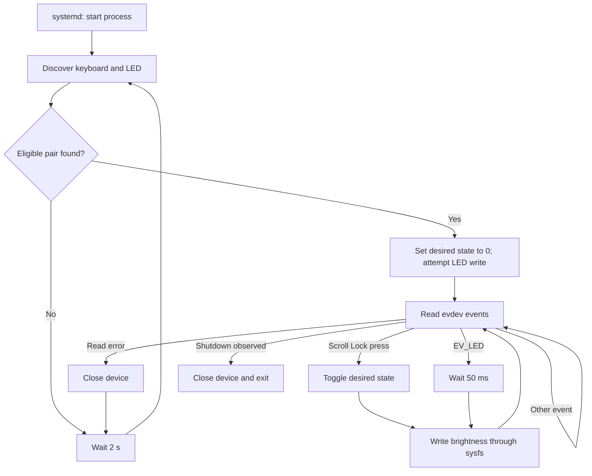

# Architecture

[Documentation index](README.md) · [Home](../README.md) · [Português (Brasil)](../pt-BR/docs/arquitetura.md)

The current implementation is a small privileged Linux service. It synchronizes a physical Scroll Lock LED with the intended on/off state, relying on keyboard firmware to control the RGB backlight.

## Components

| Component | Responsibility |
| --- | --- |
| [scrolllock-rgb.py](../scrolllock-rgb.py) | Device pairing, event loop, LED writes, logging and retry |
| [scrolllock-rgb.service](../scrolllock-rgb.service) | System-wide Python process under systemd |
| [install.sh](../install.sh) | Dependency check, deployment and service activation |
| [uninstall.sh](../uninstall.sh) | Disable service, remove installed files and reload systemd |
| [tests/](../tests/) | Syntax checks and mock-based daemon tests |

## Event and control flow

This diagram summarizes the control flow; a blocked read may delay observation of a shutdown request.

## Device pairing

1. Discover brightness nodes matching `/sys/class/leds/*:scrolllock/brightness` and group them by the resolved owning input device.
2. Enumerate evdev devices and resolve their owning device through the sysfs class link.
3. Require exactly one matching Scroll Lock LED on that same input device; a shared USB ancestor alone is insufficient.
4. Check for both `KEY_SCROLLLOCK` and `KEY_A`; return the first eligible pair and close rejected opened devices.

Missing or ambiguous matches are skipped. This avoids pairing an eligible keyboard with a different keyboard's LED solely because it appears first in a list. It does not establish support for every composite USB device.

## Runtime and privileges

- A press has `EV_KEY`, `KEY_SCROLLLOCK` and value 1; repeats and releases do not toggle the desired state.
- `EV_LED` events trigger a delayed reassertion of the stored state. The delay is 0.05 seconds.
- The desired state is not persisted; each listener starts at 0 and attempts to write that value.
- LED write failures are logged; a failed write does not itself trigger immediate rediscovery.
- Read errors trigger cleanup and rediscovery after a two-second interval. SIGINT and SIGTERM set a shutdown flag; termination timing still depends on the read loop.
- The supplied unit runs as root with `Restart=always` and `RestartSec=2`. The daemon has access to keyboard events but does not intentionally log arbitrary typed characters.

## Validation boundary

The offline tests cover mocked LED writes, toggling, pairing order, missing or ambiguous LEDs, auxiliary interfaces and re-resolution after hotplug. They do not establish physical firmware compatibility, prompt shutdown or safe deployment across distributions.

[Hardware compatibility](hardware-compatibility.md) · [Troubleshooting](troubleshooting.md) · [Security policy](../SECURITY.md)
