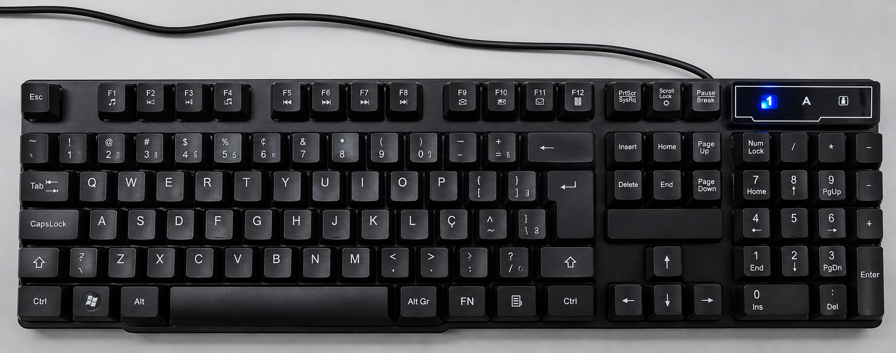
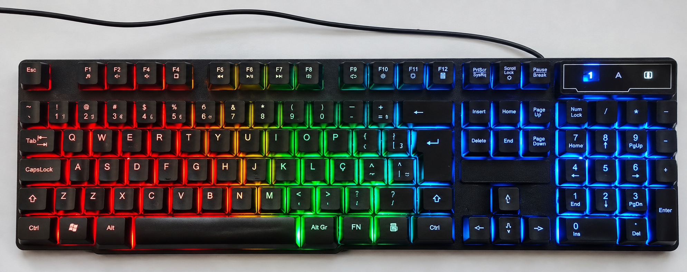
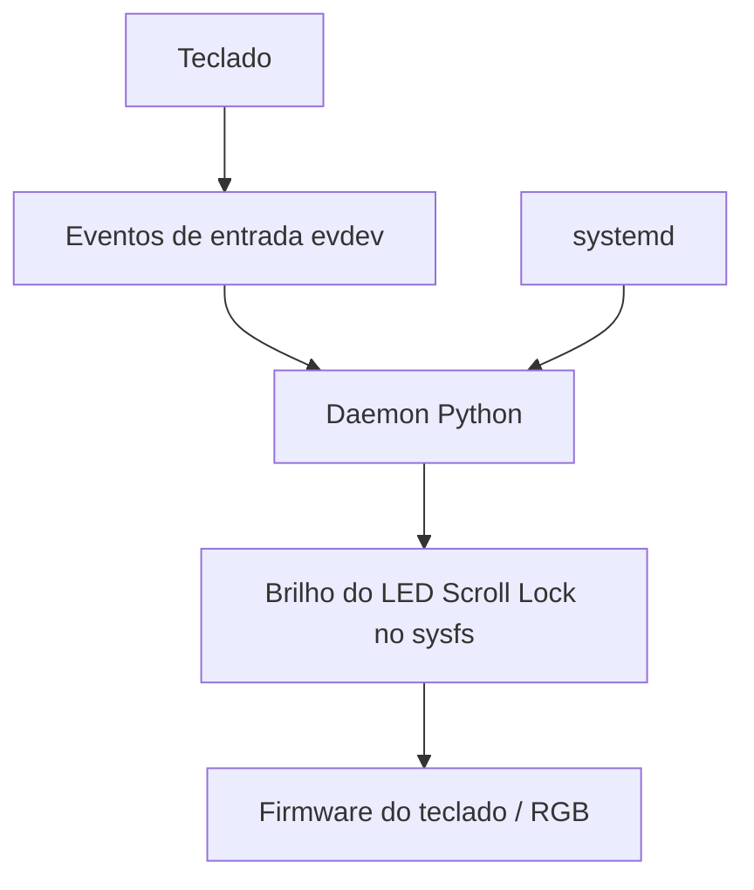

# Correção de RGB do Teclado via Scroll Lock

<div align="center">

[](../README.md)
[](docs/README.md)

[](https://kernel.org)
[](https://python.org)
[](https://systemd.io)
[](https://wayland.freedesktop.org)


[](../LICENSE)

</div>

[Instalação](#instalação) · [Diagnóstico](docs/diagnostico.md) · [Contribuição](#contribuição) · [Histórico](HISTORICO.md)

Serviço leve para Linux destinado a teclados cujo firmware liga ou desliga a iluminação RGB através do LED físico de Scroll Lock. Comecei este projeto para resolver o problema no meu próprio ambiente GNOME/Wayland. O daemon utiliza Python, evdev, sysfs e systemd em vez de um driver RGB proprietário.

## O problema

Encontrei esse problema originalmente no meu computador com Ubuntu, GNOME e Wayland, usando um teclado gamer genérico com fio. O firmware do teclado utiliza o LED físico de Scroll Lock como um interruptor para ligar ou desligar a iluminação RGB de todo o teclado.

O teclado continua funcionando para digitação mesmo com a iluminação apagada. O problema é que, em ambientes GNOME/Wayland afetados, pressionar Scroll Lock não altera o LED físico de forma confiável. Mudanças de Caps Lock ou Num Lock também podem redefinir esse LED, apagando inesperadamente a iluminação.

Este projeto oferece um serviço em segundo plano que detecta o pressionamento de Scroll Lock, escreve o estado desejado do LED pelo sysfs do Linux e o restaura após eventos de LED. Ele trata esse comportamento específico do firmware, não controla cores individuais, efeitos de iluminação ou todos os teclados RGB.

## Demonstração visual

As imagens abaixo ilustram o teclado que motivou este projeto e os dois estados da iluminação.

### Iluminação RGB desligada e ligada

| RGB desligado | RGB ligado |
|---|---|
|  |  |
| [Fotografia original](../docs/images/0-original.png) | [Fotografia original](../docs/images/1-original.png) |

### A tecla Scroll Lock


[Fotografia original](../docs/images/2-original.png)

O símbolo de iluminação na tecla Scroll Lock indica sua função neste teclado específico. O firmware utiliza o estado do LED de Scroll Lock para ligar ou desligar a iluminação; o daemon não controla diretamente os LEDs RGB individuais.

As fotografias originais vinculadas acima servem de referência para o hardware. Os [créditos das imagens](#créditos) descrevem como as versões exibidas foram preparadas.

## Como funciona



- Detecta teclados que anunciam suporte a Scroll Lock e A e localiza dinamicamente os nós de brilho do LED.
- Alterna o LED ao pressionar Scroll Lock, ignorando repetições e solturas.
- Restaura o estado desejado após eventos de LED, com espera de 50 ms.
- Repete a detecção após desconexão identificada ou ausência de dispositivo, em intervalos de dois segundos.
- Executa sob systemd, configurado para reiniciar o daemon.

O serviço usa o primeiro teclado elegível com exatamente um LED de Scroll Lock no mesmo dispositivo de entrada do Linux. Teclados sem um LED correspondente ou com mais de um são ignorados, mesmo que outro teclado tenha um LED disponível. O listener tenta inicializar o LED como apagado a cada conexão; o estado anterior não é persistido. A recuperação e o encerramento ainda precisam de validação mais abrangente.

## Compatibilidade e requisitos

| Componente | Requisito |
|---|---|
| Sistema | Linux com systemd em funcionamento |
| Runtime | Python 3 do sistema (alvo mínimo existente: 3.8) e evdev |
| Hardware | Teclado cuja iluminação responde ao LED físico de Scroll Lock |
| Acesso | sudo para instalação, gerenciamento do serviço e escrita privilegiada |
| Desenvolvimento | Git, Bash e Python com evdev |

Para uma visão detalhada da implementação, consulte a [arquitetura](docs/arquitetura.md). Para as evidências e os limites de compatibilidade, consulte [compatibilidade de hardware](docs/compatibilidade-de-hardware.md).

O instalador possui rotinas para os gerenciadores abaixo. Isso **não** representa compatibilidade comprovada em hardware.

| Família | Gerenciador | Dependência |
|---|---|---|
| Debian / Ubuntu / Linux Mint | apt | python3-evdev |
| Fedora / RHEL | dnf | python3-evdev |
| Arch / Manjaro | pacman | python-evdev |
| openSUSE | zypper | python3-evdev |
| Sistemas com apk | apk | py3-evdev |

A rotina apk não estabelece suporte ao Alpine/OpenRC: o projeto fornece uma unidade systemd, não um serviço OpenRC. A disponibilidade dos pacotes pode variar. Outros compositores e distribuições podem funcionar, mas não há garantia. O alvo original foi Ubuntu com GNOME/Wayland; consulte o [registro técnico histórico](docs/registro-tecnico.md) ([PDF original](../docs/RGB_ScrollLock_Ubuntu_EN.pdf)).

## Instalação

Revise [install.sh](../install.sh), [a unidade de serviço](../scrolllock-rgb.service) e o [guia de diagnóstico](docs/diagnostico.md). Use um equipamento não crítico e mantenha uma forma alternativa de entrada.

```sh
git clone https://github.com/kayo-willian/scrolllock-rgb-fix.git
cd scrolllock-rgb-fix
sudo ./install.sh
```

O instalador verifica o evdev, tenta instalá-lo se necessário, copia o daemon e a unidade, recarrega o systemd, habilita e inicia o serviço imediatamente. Python e Git devem estar instalados. O script pode alterar pacotes do sistema e sobrescrever os dois arquivos de destino; confira os arquivos existentes antes de executá-lo.

| Caminho instalado | Finalidade |
|---|---|
| `/usr/local/bin/scrolllock-rgb.py` | Daemon Python |
| `/etc/systemd/system/scrolllock-rgb.service` | Serviço do sistema |

**Privacidade e privilégios:** o serviço fornecido executa como root e lê eventos de teclado através de evdev. O código atual registra o dispositivo monitorado, alternâncias de Scroll Lock e erros, não caracteres digitados arbitrariamente. O daemon não precisa de rede para seu funcionamento normal; o instalador pode acessar repositórios de pacotes. A execução como root não é garantia de segurança: revise o código antes da instalação.

## Uso e diagnóstico

Pressione Scroll Lock para alternar a iluminação. Consulte o estado e os logs:

```sh
systemctl status scrolllock-rgb.service --no-pager
journalctl -u scrolllock-rgb.service -n 50 --no-pager
journalctl -u scrolllock-rgb.service -f
```

Um serviço ativo ainda pode estar aguardando um dispositivo. Confira o teclado e o LED identificados nos logs e siga o [guia de diagnóstico](docs/diagnostico.md) para testar um LED específico. Não escreva em todos os LEDs encontrados se houver vários teclados.

Para parar temporariamente ou desabilitar a inicialização automática:

```sh
sudo systemctl stop scrolllock-rgb.service
sudo systemctl disable --now scrolllock-rgb.service
```

Para habilitar novamente:

```sh
sudo systemctl enable --now scrolllock-rgb.service
```

## Atualização e remoção

Não há comando dedicado de atualização. Consulte o [histórico](HISTORICO.md), pare o serviço, atualize o clone e execute o instalador novamente apenas se aceitar a substituição dos arquivos:

```sh
sudo systemctl stop scrolllock-rgb.service
git pull --ff-only origin main
sudo ./install.sh
systemctl status scrolllock-rgb.service --no-pager
```

Para desinstalar a partir do clone:

```sh
sudo ./uninstall.sh
systemctl is-active scrolllock-rgb.service
test ! -e /usr/local/bin/scrolllock-rgb.py
test ! -e /etc/systemd/system/scrolllock-rgb.service
```

O desinstalador tenta parar e desabilitar a unidade, remove os dois caminhos fixos e recarrega o systemd. Atualmente ignora erros de parada/desabilitação; verifique o resultado de forma independente. Não remove evdev, o clone ou o histórico do journal. Unidades inativas ou ausentes podem retornar código diferente de zero. Investigue processos ou arquivos restantes sem remover arquivos de outros serviços.

## Testes e desenvolvimento

Instale evdev pelo gerenciador de sua distribuição. No Debian/Ubuntu, por exemplo:

```sh
sudo apt install -y python3-evdev
```

Execute os testes existentes como usuário comum:

```sh
bash tests/test_syntax.sh
python3 tests/test_daemon.py
```

Os testes verificam sintaxe, arquivos esperados e simulações de detecção, escrita de LED e eventos. Não comprovam compatibilidade física nem instalação segura em ambiente real. Não exigem teclado físico, root ou systemd em execução. Não execute o daemon contra dispositivos reais apenas para rodar testes unitários.

## Contribuição

São bem-vindos relatos de compatibilidade, testes de regressão, melhorias na documentação, correções de detecção de dispositivos e propostas para melhorar a instalação ou o ciclo de vida do serviço.

1. [Faça um fork](https://github.com/kayo-willian/scrolllock-rgb-fix/fork).
2. Leia o [guia de contribuição](CONTRIBUICAO.md), crie uma branch específica e execute os testes offline.
3. Realize a mudança, acrescente testes pertinentes e documente os resultados reais.
4. Abra um Pull Request para a branch `main`.

| Recurso | Finalidade |
|---|---|
| [Guia de contribuição](CONTRIBUICAO.md) | Fluxo, segurança e testes |
| [Código de conduta](CODIGO-DE-CONDUTA.md) | Participação respeitosa |
| [Política de segurança](SEGURANCA.md) | Comunicação privada responsável |
| [Issues](https://github.com/kayo-willian/scrolllock-rgb-fix/issues) | Erros, compatibilidade e propostas |
| [Pull Requests](https://github.com/kayo-willian/scrolllock-rgb-fix/pulls) | Alterações propostas e revisões |
| [Histórico](HISTORICO.md) | Histórico de desenvolvimento |

As issues criadas pelo projeto e seus modelos são bilíngues; participantes podem escrever em inglês ou português brasileiro. Código, commits e PRs utilizam inglês. O README, o guia de contribuição, o código de conduta e a política de segurança estão disponíveis em inglês e português brasileiro em [pt-BR/](README.md). O guia de diagnóstico, o registro técnico histórico e o histórico de alterações também têm tradução para português brasileiro. As contribuições são revisadas quando houver disponibilidade; não há prazo garantido de resposta ou lançamento. Forks independentes permanecem livres para evoluir sob MIT.

## Créditos

As imagens exibidas são versões aprimoradas por IA das minhas fotografias originais. Alguns detalhes, incluindo as inscrições das teclas, podem diferir do equipamento real. As fotografias originais vinculadas são a referência para a aparência física. As imagens ilustram o problema e o comportamento pretendido; não comprovam testes de uma revisão específica do daemon.

## Licença

[Licença MIT](../LICENSE).
