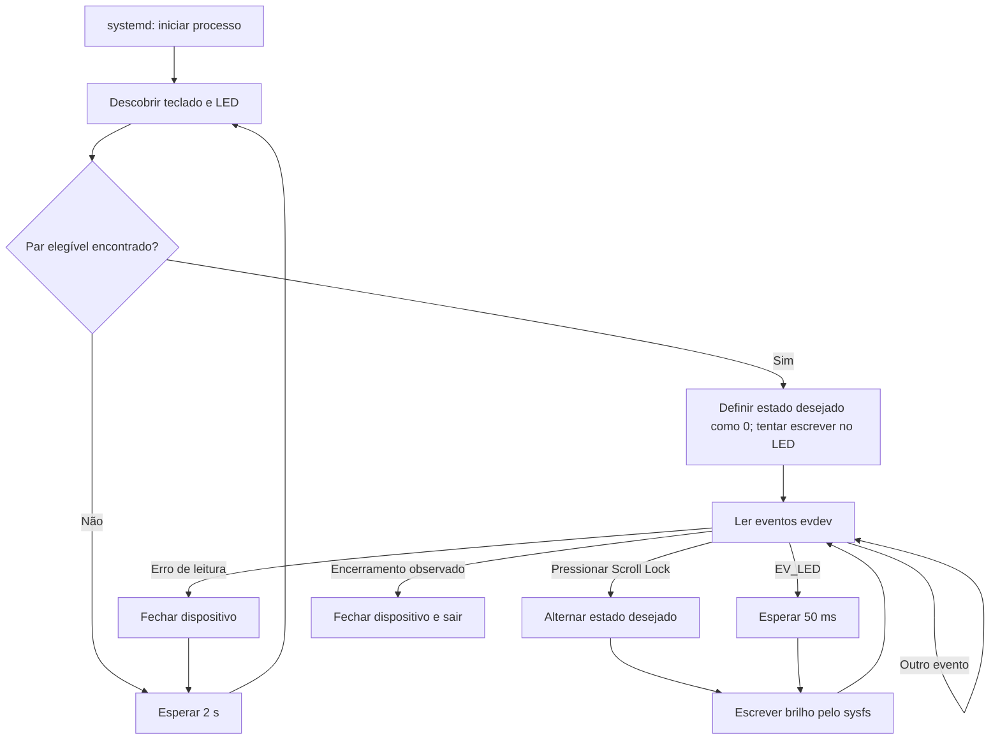

# Arquitetura

[Índice da documentação](README.md) · [Início](../README.md) · [English](../../docs/architecture.md)

A implementação atual é um pequeno serviço privilegiado para Linux. Ele sincroniza um LED físico de Scroll Lock com o estado desejado de ligado/desligado, dependendo do firmware do teclado para controlar a iluminação RGB.

## Componentes

| Componente | Responsabilidade |
| --- | --- |
| [scrolllock-rgb.py](../../scrolllock-rgb.py) | Associação de dispositivos, laço de eventos, escritas no LED, logs e novas tentativas |
| [scrolllock-rgb.service](../../scrolllock-rgb.service) | Processo Python do sistema sob systemd |
| [install.sh](../../install.sh) | Verificação de dependências, instalação e ativação do serviço |
| [uninstall.sh](../../uninstall.sh) | Desabilitar serviço, remover arquivos instalados e recarregar systemd |
| [tests/](../../tests/) | Verificações de sintaxe e testes simulados do daemon |

## Fluxo de eventos e controle

Este diagrama resume o fluxo de controle; uma leitura bloqueada pode atrasar a observação de um pedido de encerramento.

## Associação de dispositivos

1. Descobrir nós de brilho correspondentes a `/sys/class/leds/*:scrolllock/brightness` e agrupá-los pelo dispositivo de entrada proprietário resolvido.
2. Enumerar dispositivos evdev e resolver seu dispositivo proprietário pelo vínculo de classe no sysfs.
3. Exigir exatamente um LED de Scroll Lock correspondente nesse mesmo dispositivo de entrada; apenas compartilhar um ancestral USB é insuficiente.
4. Verificar `KEY_SCROLLLOCK` e `KEY_A`; retornar o primeiro par elegível e fechar os dispositivos abertos rejeitados.

Correspondências ausentes ou ambíguas são ignoradas. Isso evita associar um teclado elegível ao LED de outro teclado apenas porque aparece primeiro em uma lista. Não estabelece suporte a todos os dispositivos USB compostos.

## Execução e privilégios

- Um pressionamento tem `EV_KEY`, `KEY_SCROLLLOCK` e valor 1; repetições e solturas não alternam o estado desejado.
- Eventos `EV_LED` acionam uma reaplicação do estado armazenado após uma espera. O atraso é de 0.05 segundo.
- O estado desejado não é persistido; cada listener começa em 0 e tenta escrever esse valor.
- Falhas de escrita no LED são registradas; uma falha de escrita por si só não aciona redescoberta imediata.
- Erros de leitura acionam limpeza e redescoberta após dois segundos. SIGINT e SIGTERM definem um indicador de encerramento; o tempo de término ainda depende do laço de leitura.
- A unidade fornecida executa como root com `Restart=always` e `RestartSec=2`. O daemon tem acesso a eventos de teclado, mas não registra intencionalmente caracteres digitados arbitrários.

## Limites da validação

Os testes offline abrangem escritas simuladas no LED, alternância, ordem de associação, LEDs ausentes ou ambíguos, interfaces auxiliares e nova resolução após hotplug. Não estabelecem compatibilidade física do firmware, encerramento imediato ou instalação segura em várias distribuições.

[Compatibilidade de hardware](compatibilidade-de-hardware.md) · [Diagnóstico](diagnostico.md) · [Política de segurança](../SEGURANCA.md)
